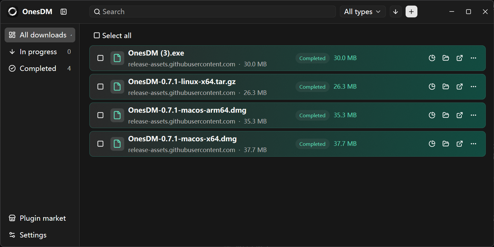

<div align="center">
  
  <h1><picture><source media="(prefers-color-scheme: dark)" srcset="assets/onesdm.svg"></picture> OnesDM</h1>
  <p>Ones Download Manager · PlayOnes · AI-Native Download Manager</p>
  <p><strong>Any Agent. All Downloads.</strong></p>
  <p>KI-nativer Downloadmanager für Windows, macOS und Linux. OnesDM ist in Rust mit GPUI geschrieben und verbindet den speichersicheren ODM Core mit erweiterbaren Download-Engines und optionalen KI-Clients.</p>
  <p><a href="https://github.com/AreChen/OnesDM/releases/latest"><strong>Herunterladen</strong></a> · <a href="https://odm.playones.com/de/">odm.playones.com</a></p>
</div>

<p align="center"><a href="README.md">English</a> · <a href="README.zh-CN.md">简体中文</a> · <a href="README.zh-Hant.md">繁體中文</a> · <a href="README.ja.md">日本語</a> · <a href="README.ko.md">한국어</a> · <a href="README.es.md">Español</a> · <a href="README.pt-BR.md">Português (Brasil)</a> · <a href="README.fr.md">Français</a> · <strong>Deutsch</strong></p>

## Funktionen

- HTTP(S)-Downloads mit mehreren Verbindungen und Wiederaufnahme sowie Übertragungen über FTP(S) und SFTP.
- HLS und statische DASH-Streams speichern. Im Browser erkannte Videos und Audiospuren durchsuchen und mehrere Ressourcen gemeinsam herunterladen.
- Nach Dateiname, Quelle oder URL suchen, nach Kategorie filtern und mit der Umschalttaste einen Bereich auswählen. Dateien direkt aus der Liste öffnen.
- Download- und Cache-Ordner wählen, Speicher freigeben und den Proxy für einzelne Aufträge festlegen.
- Kompakte Fortschrittsfenster, helles und dunkles Design und neun Sprachen. Ein neues Profil übernimmt eine unterstützte Systemsprache. Die Auswahl lässt sich unter **Einstellungen → Darstellung und Sprache** ändern.

## Bildschirmfotos

### Helles Design · Einstellungen

[](assets/readme/downloads-light.png)

### Dunkles Design · Downloads

[](assets/readme/downloads-dark.png)

## Herunterladen

[Installationspaket auf GitHub Releases herunterladen](https://github.com/AreChen/OnesDM/releases/latest)

| Plattform | Paket | Installation |
| --- | --- | --- |
| Windows · x64 | `OnesDM.exe` | Installationsprogramm ausführen. |
| macOS 12+ · Apple Silicon | `OnesDM-*-macos-arm64.dmg` | OnesDM in den Ordner „Programme“ ziehen. |
| macOS 12+ · Intel | `OnesDM-*-macos-x64.dmg` | OnesDM in den Ordner „Programme“ ziehen. |
| Linux · x86-64 | `OnesDM-*-linux-x64.tar.gz` | [Linux-Abhängigkeiten](desktop/packaging/linux/README.md) installieren, das Archiv entpacken und `ndm-desktop` starten. |

**Update von 0.6.8, 0.6.9 oder 0.7.0**　Diese Versionen überspringen Pakete von der aktuellen GitHub-Adresse. Downloads pausieren oder abschließen, die App vollständig beenden und einmalig 0.7.1 oder neuer von Hand installieren. Ein beibehaltenes Profil übernimmt Verlauf, Einstellungen und Plugins.

Weitere Updates lassen sich in der App suchen. OnesDM prüft Paketgröße und SHA-256. Windows installiert nach Abschluss der Aufträge. macOS ersetzt die App oder öffnet bei Bedarf das DMG. Linux öffnet den Ordner mit dem Archiv.

Neue Profile erlauben bis zu 16 HTTP-Verbindungen pro Download. Die Segmentgröße richtet sich nach Dateigröße und Antwortzeit der ersten Anfrage. Vorhandene Einstellungen bleiben erhalten.

## Befehlszeile

Den Ordner mit `onesdm` zum PATH hinzufügen oder das Programm mit vollständigem Pfad aufrufen. Unter macOS liegt es in `OnesDM.app/Contents/MacOS`. Per Befehlszeile lassen sich HTTP(S)-Links in die Warteschlange einfügen und der MCP-Server über die Standardein- und -ausgabe starten.

```text
onesdm --version
onesdm download <URL>
onesdm mcp
```

## Plugins und KI


Das Plugin **BitTorrent** verarbeitet .torrent-Dateien und Magnetlinks. **Media Downloader** lädt Videos, Audio und Wiedergabelisten von unterstützten Websites. Beide Engines sind im Plugin-Katalog erhältlich. [GitHub](https://github.com/AreChen/onesdm-plugin-market)

OpenAI Codex (CLI und Desktop), Claude Code, Pi, OpenCode und DeepSeek Harness können mit OnesDM MCP und dem zugehörigen Skill Downloads hinzufügen und verwalten. [Anleitung für Plugins und KI](docs/plugins-and-ai.md)

## Browser-Erweiterung

Chrome, Edge und Brave übergeben Downloads anhand von Dateityp, Größe und Domain. Neben den Medien stehen optionale Schaltflächen zur Verfügung. In der Ressourcenbibliothek lassen sich mehrere Dateien gemeinsam auswählen. Jede Version enthält ein passendes Erweiterungs-ZIP. OnesDM als Downloadmanager auswählen. Neat Download Manager wird ebenfalls unterstützt. [Installationsanleitung für die Erweiterung](docs/extension-install.md)

[Windows](desktop/packaging/windows/README.md#browser-extension) · [macOS](desktop/packaging/macos/README.md#browser-extension) · [Linux](desktop/packaging/linux/README.md#browser-extension)

<details>
<summary><strong>Build und Veröffentlichung</strong></summary>

Ein Tag im Format desktop-vX.Y.Z startet den GitHub-Actions-Build für Windows, beide macOS-Architekturen, Linux und die Erweiterung. Nach erfolgreichen Tests werden die Pakete veröffentlicht. [GitHub Actions](.github/workflows/release.yml)

[Windows](desktop/packaging/windows/README.md) · [macOS](desktop/packaging/macos/README.md) · [Linux](desktop/packaging/linux/README.md)

</details>

---

[MIT](LICENSE) · [Datenschutz](PRIVACY.md) · Unabhängiges Projekt ohne Verbindung zu Neat Download Manager.
