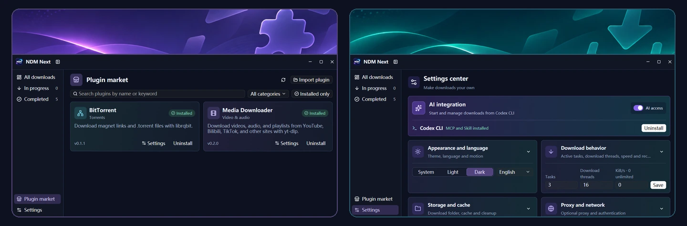

<div align="center">
  
  <h1><picture><source media="(prefers-color-scheme: dark)" srcset="assets/onesdm.svg"></picture> OnesDM</h1>
  <p>Ones Download Manager · PlayOnes · AI-Native Download Manager</p>
  <p><strong>Any Agent. All Downloads.</strong></p>
  <p>Rust와 GPUI로 만든 Windows, macOS, Linux용 AI 네이티브 다운로드 관리자입니다. 메모리 안전성을 갖춘 ODM Core에 다운로드 플러그인과 AI 클라이언트를 연결할 수 있습니다.</p>
  <p><a href="https://github.com/AreChen/OnesDM/releases/latest"><strong>다운로드</strong></a> · <a href="https://odm.playones.com/ko/">odm.playones.com</a></p>
</div>

<p align="center"><a href="README.md">English</a> · <a href="README.zh-CN.md">简体中文</a> · <a href="README.zh-Hant.md">繁體中文</a> · <a href="README.ja.md">日本語</a> · <strong>한국어</strong> · <a href="README.es.md">Español</a> · <a href="README.pt-BR.md">Português (Brasil)</a> · <a href="README.fr.md">Français</a> · <a href="README.de.md">Deutsch</a></p>

## 기능

- HTTP(S) 다중 연결과 이어받기, FTP(S), SFTP를 지원합니다.
- HLS와 정적 DASH를 받을 수 있습니다. 브라우저에서 감지한 동영상과 오디오를 검색해 한꺼번에 다운로드하세요.
- 이름, 출처, URL로 파일을 찾고 유형별로 필터링합니다. Shift로 여러 항목을 선택하거나 목록에서 파일을 바로 열 수 있습니다.
- 다운로드 및 캐시 폴더를 설정하고, 캐시를 정리하거나 작업마다 다른 프록시를 쓸 수 있습니다.
- 독립 진행 창과 밝은 테마, 어두운 테마를 제공합니다. 처음에는 시스템에서 선호하는 지원 언어를 사용하며, ‘설정 → 모양 및 언어’에서 9개 언어 중 하나를 선택할 수 있습니다.

## 다운로드

[GitHub Releases에서 설치 파일 받기](https://github.com/AreChen/OnesDM/releases/latest)

| 플랫폼 | 패키지 | 설치 방법 |
| --- | --- | --- |
| Windows · x64 | `OnesDM.exe` | 설치 프로그램을 실행합니다. |
| macOS 12+ · Apple Silicon | `OnesDM-*-macos-arm64.dmg` | OnesDM을 응용 프로그램 폴더로 드래그합니다. |
| macOS 12+ · Intel | `OnesDM-*-macos-x64.dmg` | OnesDM을 응용 프로그램 폴더로 드래그합니다. |
| Linux · x86-64 | `OnesDM-*-linux-x64.tar.gz` | [필수 라이브러리](desktop/packaging/linux/README.md)를 설치한 뒤 압축을 풀고 `ndm-desktop`을 실행합니다. |

**0.6.8, 0.6.9, 0.7.0에서 업그레이드**　이 버전들은 현재 GitHub 주소의 패키지를 찾지 못합니다. 다운로드를 일시 중지하거나 완료한 후 앱을 완전히 종료하고 0.7.1 이상을 한 번 수동 설치하세요. 기존 프로필을 유지하면 다운로드 기록, 설정과 플러그인을 그대로 사용할 수 있습니다.

이후에는 앱에서 업데이트를 확인할 수 있습니다. 패키지 크기와 SHA-256을 검증한 뒤 Windows는 작업이 끝나면 설치합니다. macOS는 앱을 교체하거나 필요할 때 DMG를 엽니다. Linux는 압축 파일이 있는 폴더를 엽니다.

새 프로필은 HTTP 다운로드마다 최대 16개 연결을 사용합니다. 파일 크기와 첫 요청의 응답 시간에 따라 구간 크기를 정합니다. 기존 연결 설정은 유지됩니다.

## 명령줄

설치 폴더의 `onesdm`을 PATH에 추가하거나 전체 경로로 실행하세요. macOS에서는 `OnesDM.app/Contents/MacOS`에 있습니다. HTTP(S) 링크를 데스크톱 대기열에 추가하거나 표준 입출력 MCP 서비스를 시작할 수 있습니다.

```text
onesdm --version
onesdm download <URL>
onesdm mcp
```

## 스크린샷

<picture>
  <source media="(prefers-color-scheme: dark)" srcset="assets/readme/downloads-dark.webp">
  
</picture>

[어두운 테마 원본 보기](assets/readme/downloads-dark.webp) · [밝은 테마 원본 보기](assets/readme/downloads-light.webp)

## 플러그인 및 AI



플러그인 마켓에서 **BitTorrent**를 설치하면 .torrent와 마그넷 링크를 받을 수 있습니다. **Media Downloader**는 지원 사이트의 영상, 오디오, 재생목록을 다운로드합니다. [GitHub](https://github.com/AreChen/onesdm-plugin-market)

OpenAI Codex(CLI 및 데스크톱), Claude Code, Pi, OpenCode, DeepSeek Harness에서 OnesDM MCP와 Skill로 다운로드를 추가하고 관리할 수 있습니다. [플러그인 및 AI 설정 안내](docs/plugins-and-ai.md)

## 브라우저 확장 프로그램

Chrome, Edge, Brave에서 파일 유형, 크기, 도메인으로 다운로드를 선별합니다. 미디어 옆 버튼이나 별도 리소스 창에서 일괄 다운로드할 수 있습니다. 각 릴리스의 확장 프로그램 ZIP을 사용하고 연결 대상으로 OnesDM을 고르세요. Neat Download Manager도 지원합니다. [확장 프로그램 설치 안내](docs/extension-install.md)

[Windows](desktop/packaging/windows/README.md#browser-extension) · [macOS](desktop/packaging/macos/README.md#browser-extension) · [Linux](desktop/packaging/linux/README.md#browser-extension)

<details>
<summary><strong>빌드 및 릴리스</strong></summary>

desktop-vX.Y.Z 태그를 푸시하면 GitHub Actions가 Windows, 두 macOS 아키텍처, Linux와 확장 프로그램을 빌드하고 테스트가 통과한 후 배포합니다. [GitHub Actions](.github/workflows/release.yml)

[Windows](desktop/packaging/windows/README.md) · [macOS](desktop/packaging/macos/README.md) · [Linux](desktop/packaging/linux/README.md)

</details>

---

[MIT](LICENSE) · [개인정보 처리방침](PRIVACY.md) · Neat Download Manager와 제휴하지 않은 독립 프로젝트입니다.
