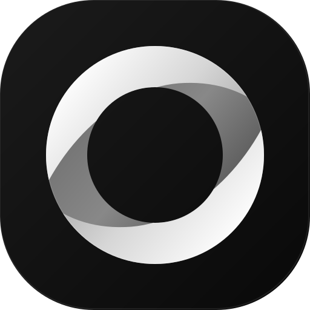
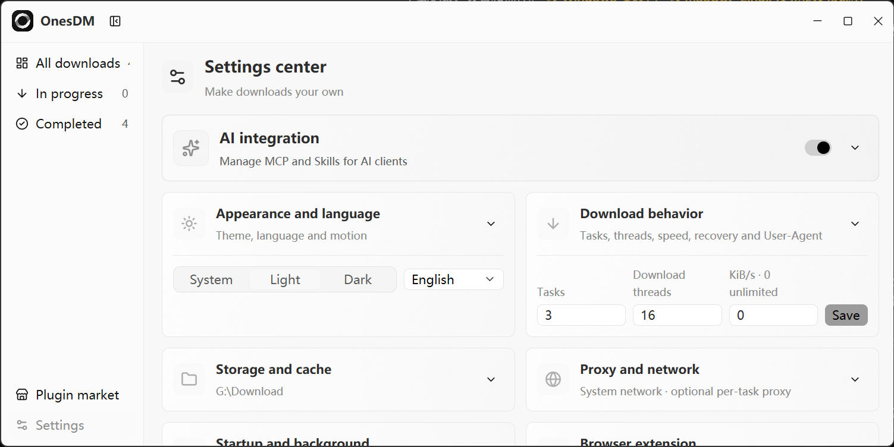

  
  <h1> OnesDM</h1>
  
Ones Download Manager · PlayOnes · AI-Native Download Manager

  
<strong>Any Agent. All Downloads.</strong>

  
Built with Rust and GPUI for Windows, macOS, and Linux, with a memory-safe core, pluggable download engines, and optional AI integration.

  
Download torrents, magnet links, and streaming media with optional engines from the <a href="#plugins-and-ai">desktop plugin market</a>.

  

    
    
    
    
  

  
<a href="https://github.com/AreChen/onesdm/releases/latest"><strong>Download</strong></a> · <a href="#features">Features</a> · <a href="#screenshots">Screenshots</a> · <a href="#browser-extension">Browser extension</a> · <a href="README.zh-CN.md">简体中文</a>

## Features

| Downloads & media | Everyday controls |
| :--- | :--- |
| **Fast transfers** — HTTP(S), FTP(S) and SFTP, with multi-connection HTTP(S) downloads. | **Browser integration** — Capture downloads with file type, size and domain filters. |
| **Media downloads** — HLS and static DASH, plus a searchable resource library and batch downloads. | **Organized tasks** — Multilingual search, category filters, Shift-click range selection, and quick file actions. |
| **Storage & network** — Custom download/cache folders, cache cleanup and per-task proxy controls. | **Native interface** — Smooth motion, compact progress windows, light/dark themes, and English/Chinese support. |

## Download

Get your installer from [**GitHub Releases →**](https://github.com/AreChen/onesdm/releases/latest).

| Platform | Package | Install |
| :--- | :--- | :--- |
| Windows · x64 | `OnesDM.exe` | Run the installer. |
| macOS 12+ · Apple Silicon | `OnesDM-*-macos-arm64.dmg` | Drag **OnesDM** to **Applications**. |
| macOS 12+ · Intel | `OnesDM-*-macos-x64.dmg` | Drag **OnesDM** to **Applications**. |
| Linux · x86-64 | `OnesDM-*-linux-x64.tar.gz` | Install the [Linux dependencies](desktop/packaging/linux/README.md), extract the archive, and run `ndm-desktop`. |

The app checks GitHub for updates. Click **Upgrade** to download a verified package. Windows installs when idle, macOS opens the DMG, and Linux opens the folder containing the archive.

New profiles allow up to 16 concurrent HTTP ranges per download and start at login. The downloader chooses range sizes using the file size and the time the server took to answer the initial probe. Existing settings are preserved.

## Command line

The installed desktop package includes `onesdm`. Add its folder to your shell PATH or run the executable by path. On macOS it is inside `OnesDM.app/Contents/MacOS`. Use `onesdm download <URL>` to queue an HTTP(S) link in the desktop, `onesdm mcp` for stdio integration, or `onesdm --version`.

## Screenshots

NDM Next 0.6.x interface.

| Dark theme | Light theme |
| :---: | :---: |
|  |  |

## Plugins and AI

Install **BitTorrent** for `.torrent` files and magnet links, or **Media Downloader** for streaming video, audio, and playlists from supported sites. Both engines are available in the [desktop plugin market](assets/readme/plugin-market.webp).

Use AI integration to queue and manage downloads from OpenAI Codex (CLI and desktop), Claude Code, Pi, OpenCode, and DeepSeek Harness through MCP and the companion Skill. [Plugin and AI setup guide](docs/plugins-and-ai.md)

## Browser extension

Connect **Chrome, Edge or Brave** to capture downloads and discover webpage media. Optional download buttons appear beside media; the separate media library lets you search, select and download resources in batches.

Each release includes its matching versioned extension ZIP. Follow the [extension installation guide](docs/extension-install.md).

**Platform details:** [Windows](desktop/packaging/windows/README.md#browser-extension) · [macOS](desktop/packaging/macos/README.md#browser-extension) · [Linux](desktop/packaging/linux/README.md#browser-extension). Select **OnesDM** as the extension backend. The extension also supports Neat Download Manager.

<strong>Build & release</strong>

GitHub Actions builds the Windows installer, both macOS DMGs, and the Linux archive. Pushing a `desktop-vX.Y.Z` tag runs the [release workflow](.github/workflows/release.yml), which publishes the packages and matching companion extension after all builds and tests succeed.

Local build guides: [Windows](desktop/packaging/windows/README.md) · [macOS](desktop/packaging/macos/README.md) · [Linux](desktop/packaging/linux/README.md).

---

[MIT License](LICENSE) · [Privacy](PRIVACY.md) · Independent project, not affiliated with Neat Download Manager.
