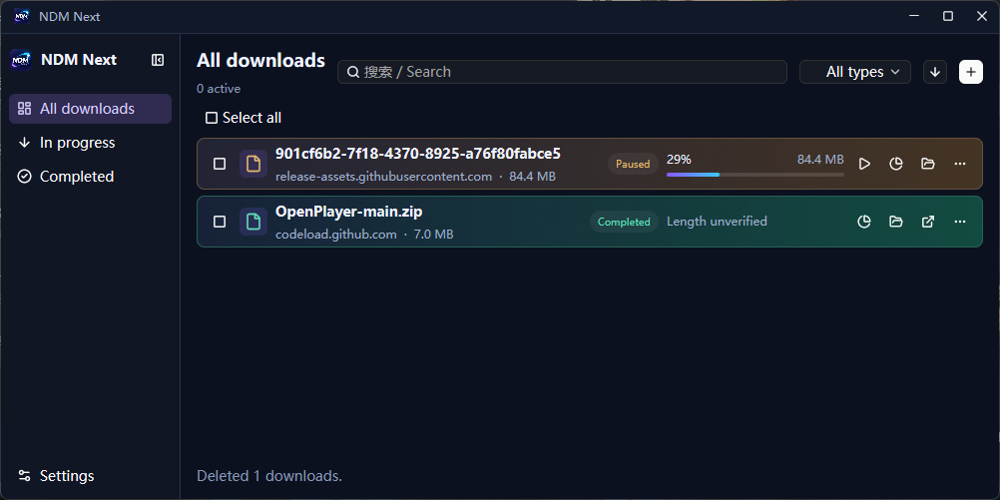

  
  <h1>NDM Next</h1>
  
<strong>高性能 · 内存安全 · 现代美观</strong>

  
使用 Rust 与 GPUI 构建的 Windows、macOS 和 Linux 下载管理器，搭配精致的原生界面。

  

    
    
    
    
  

  
<a href="https://github.com/AreChen/NDM-Next/releases/latest"><strong>下载应用</strong></a> · <a href="#功能">功能</a> · <a href="#浏览器扩展">浏览器扩展</a> · <a href="README.md">English</a>

  

## 功能

| 下载与资源 | 操作与体验 |
| :--- | :--- |
| **多协议下载** — 支持 HTTP(S)、FTP(S)、SFTP，HTTP(S) 支持多连接下载。 | **浏览器接管** — 按文件类型、大小及域名过滤下载，减少无用文件干扰。 |
| **媒体下载** — 支持 HLS、静态 DASH，提供可搜索的媒体资源窗口和批量下载。 | **任务管理** — 多语言搜索、分类筛选、Shift 连续多选，以及快捷打开文件。 |
| **存储与网络** — 自定义下载及缓存目录、清理缓存，为单个任务启用代理。 | **原生界面** — 平滑动效、紧凑进度窗口、亮暗主题、中英文切换。 |

## 下载

前往 [**GitHub Releases 获取安装包 →**](https://github.com/AreChen/NDM-Next/releases/latest)。

| 平台 | 安装包 | 安装方式 |
| :--- | :--- | :--- |
| Windows · x64 | `NDM-Next-Setup-*-x64.exe` | 运行安装程序。 |
| macOS 12+ · Apple Silicon | `NDM-Next-*-macos-arm64.dmg` | 将 **NDM Next** 拖入 **Applications**。 |
| macOS 12+ · Intel | `NDM-Next-*-macos-x64.dmg` | 将 **NDM Next** 拖入 **Applications**。 |
| Linux · x86-64 | `NDM-Next-*-linux-x64.tar.gz` | 安装 [Linux 运行依赖](desktop/packaging/linux/README.md)，解压并运行 `ndm-desktop`。 |

应用通过 GitHub 检查更新。点击**升级**下载并校验安装包。Windows 在空闲时安装，macOS 打开 DMG，Linux 打开压缩包所在目录。

新安装默认使用 16 个下载连接并开启开机自启，已有设置会保留。

## 浏览器扩展

连接 **Chrome、Edge 或 Brave**，接管下载并嗅探网页媒体。可选开启媒体旁的下载按钮，也可打开独立媒体资源窗口，搜索、选择并批量下载。

每次 Release 均附带对应版本的扩展 ZIP。按照[扩展安装说明](docs/extension-install.md)连接浏览器。

**平台说明** [Windows](desktop/packaging/windows/README.md#browser-extension) · [macOS](desktop/packaging/macos/README.md#browser-extension) · [Linux](desktop/packaging/linux/README.md#browser-extension)。扩展后端请选择 **NDM Next**。扩展也支持连接 Neat Download Manager。

<strong>构建与发布</strong>

GitHub Actions 构建 Windows 安装包、macOS 双架构 DMG 和 Linux 压缩包。推送 `desktop-vX.Y.Z` 标签后，[发布工作流](.github/workflows/release.yml)会在各平台构建和测试成功后发布安装包及对应扩展。

本地构建说明 [Windows](desktop/packaging/windows/README.md) · [macOS](desktop/packaging/macos/README.md) · [Linux](desktop/packaging/linux/README.md)。

---

[MIT 许可证](LICENSE) · [隐私说明](PRIVACY.md) · 独立项目，与 Neat Download Manager 官方无关联。
